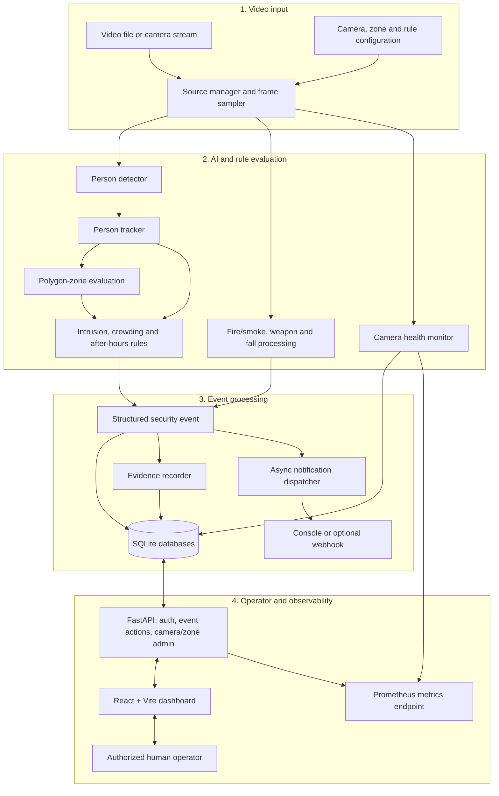
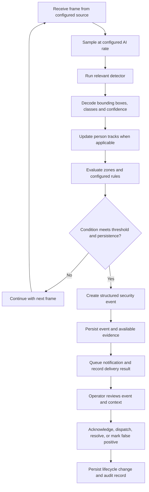
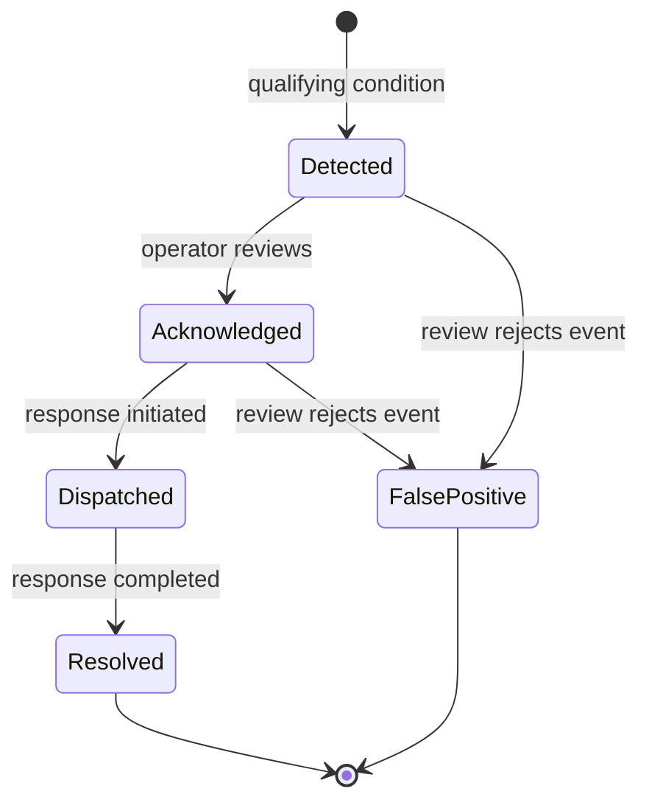

# 🏨 HOTEL AI SECURITY

<p align="center">
  <strong>AI-assisted CCTV monitoring, security-event detection, and operator response for hotel environments.</strong>
</p>

<p align="center">
  <a href="https://github.com/utkarsh-sh/HOTEL-AI-SECURITY/actions/workflows/tests.yml"></a>
  
  
  
  
  
</p>

<p align="center">
  <a href="#project-overview">Overview</a> ·
  <a href="#capabilities">Capabilities</a> ·
  <a href="#architecture">Architecture</a> ·
  <a href="#models-and-detection-logic">Models</a> ·
  <a href="#quick-start">Quick start</a> ·
  <a href="#project-status-and-roadmap">Roadmap</a>
</p>

---

## Project overview

**HOTEL AI SECURITY** is an AI-assisted CCTV security and event-management system designed to help hotel teams notice selected potential security incidents sooner and handle them through a traceable operator workflow.

It connects video ingestion, computer-vision inference, person tracking, configurable spatial and temporal rules, event persistence, evidence recording, notifications, an authenticated management API, and a React web interface. Monitoring components also track camera health and host/API metrics.

The aim is not to replace security staff. It is to provide earlier signals, consistent event handling, recorded evidence, and operational visibility so that people can investigate and decide what action is appropriate.

> **Current stage: controlled pilot / shadow operation.** The repository contains substantial application logic and automated tests, but is not yet a production-ready enterprise deployment. Required model artifacts, detection quality, camera-scale performance, security, and operational recovery must be validated in the intended environment before real-world reliance.

### At a glance

| Area | Current implementation |
|---|---|
| Video input | OpenCV-based source abstraction, frame sampling, camera workers |
| People detection | TorchVision SSDLite320 MobileNet V3 Large |
| Additional vision | ONNX Runtime fire/smoke and gun/knife model adapters |
| Event logic | Polygon-zone intrusion, crowding, configurable after-hours, fall heuristics |
| Event operations | Persisted events, evidence clips, acknowledge/dispatch/resolve/false-positive workflow |
| Web interface | React 19 + Vite dashboard |
| API and access control | FastAPI, JWT authentication, role checks, Argon2 password hashing, login rate limiting |
| Storage | SQLite application and operational databases |
| Notifications | Console provider; optional JSON webhook provider |
| Observability | Camera/system health, resource thresholds, Prometheus metrics endpoint |
| Quality checks | Pytest suite; GitHub Actions Python tests and frontend lint/build |

### Repository and documentation

- **GitHub repository:** [utkarsh-sh/HOTEL-AI-SECURITY](https://github.com/utkarsh-sh/HOTEL-AI-SECURITY)
- [Deployment guide](docs/DEPLOYMENT.md)
- [Pilot runbook](docs/PILOT_RUNBOOK.md)
- [Local setup](docs/setup.md)
- [Model acquisition and verification](docs/model_acquisition.md)

## The real-world problem

Hotel teams may need to monitor several spaces at once, such as lobbies, corridors, service entrances, and restricted areas. Continuous manual observation can make it hard to notice every unusual event promptly, maintain consistent records, or reconstruct what happened after an incident.

This project is intended to support those workflows by:

- Detecting selected visual patterns and configured rule violations from video.
- Converting qualifying observations into structured security events.
- Associating events with a camera, zone, event type, severity, timestamp, and tracked person where relevant.
- Recording evidence and notification outcomes for review.
- Letting authorized operators inspect events, evidence, and camera health.
- Recording selected event lifecycle actions in audit history.
- Exposing service and resource metrics for troubleshooting.

### Intended users

| User | Intended interaction |
|---|---|
| Security operator / viewer | Review events, inspect evidence, check camera health, and follow up on alerts |
| Security administrator | Manage authorized access and administer cameras/zones through supported API operations |
| Engineering / operations | Validate models, maintain configuration, monitor service health, and investigate failures |
| Manager / project owner | Review project capabilities, readiness, risks, test evidence, and planned milestones |

### Design principles

1. **Human oversight:** detections are prompts for review, not autonomous decisions.
2. **Traceability:** events, notification outcomes, and selected operator actions are recorded.
3. **Explicit configuration:** camera sources, zones, rules, and retention settings must be reviewed per site.
4. **Visible failure:** a failed camera or model must never be treated as proof that an area is safe.
5. **Reproducibility:** external model files must be verified; secrets and runtime data must not be committed.
6. **Measured readiness:** feature completeness is not the same as operational readiness.

## Capabilities

| Capability | Function | Current state and caveat |
|---|---|---|
| Video ingestion and frame sampling | Opens configured sources and controls frames sent to inference | Implemented; target source compatibility requires validation |
| Person detection | Detects people and returns bounding boxes/confidence | Implemented with pretrained TorchVision weights |
| Person tracking | Associates detections between frames and handles some missed detections | Custom Kalman prediction plus IoU/centre-distance association |
| Restricted-zone intrusion | Checks a tracked person against a camera-scoped polygon and persistence rule | Implemented; zones must match the actual camera view |
| Crowding | Raises an event when active tracked-person count remains above a threshold | Implemented; sample defaults use 5 people over 3 frames |
| After-hours presence | Evaluates presence against a configured schedule, time zone, and zones | Implemented, but **disabled in the current sample rules configuration** |
| Fire/smoke | Runs an ONNX detector and converts persistent observations to events | Code implemented; external model file must be supplied and verified |
| Weapon detection | Runs an ONNX gun/knife detector and produces weapon events | Code implemented; external model file must be supplied and verified |
| Potential fall/person-down | Uses bounding-box shape across consecutive frames as a lightweight signal | Heuristic only; not a trained pose model or certified life-safety system |
| Camera health | Records health state, observed FPS, transitions, and history | Implemented; field reliability requires pilot observation |
| Event evidence | Records video evidence around supported events | Implemented; target codecs, disk growth, and load must be tested |
| Event lifecycle | Supports acknowledge, dispatch, resolve, and false-positive actions | Implemented through authenticated API operations with audit-aware persistence |
| Camera and zone administration | Provides administrative CRUD operations in the backend API | Implemented; runner restart may be required for configuration changes |
| Notifications | Console notifications plus optional JSON webhook | Implemented; receiver availability and escalation are deployment-specific |
| Authentication and authorization | JWT, role checks, password hashing, login rate limiting | Implemented; production secret management and security review remain necessary |
| Retention | Configurable cleanup for retained event/evidence records | Current configuration is 30 days; confirm site policy and legal requirements |
| Metrics and monitoring | Collects host/camera data and exposes Prometheus-format metrics | Metrics endpoint implemented; Grafana dashboards not included yet |
| Web dashboard | Browser UI for login and reviewing operational/event information | Implemented; validate operator experience against target workflows |

The sample configuration describes CAM-001 with a file-based video source, an example restricted zone named restricted_01, and a processing rate of 5 FPS. These are development/pilot defaults—not a validated hotel deployment. Replace and verify them before a pilot.

## Architecture

The design separates video/AI processing, event persistence and notifications, and operator/API/monitoring access.



### Component responsibilities

- **Video layer:** opens configured sources, samples frames, and manages camera workers.
- **Vision layer:** produces detections. Person detection is separate from the external fire/smoke and weapon models.
- **Tracking and rules:** maintain short-lived person track IDs and evaluate spatial/temporal conditions.
- **Event layer:** structures and persists events, records available evidence, and queues notifications.
- **Backend:** provides authenticated access to events, cameras, health, evidence, and supported actions.
- **Frontend:** lets authorized operators review the system in a browser.
- **Monitoring:** exports selected camera, resource, and API indicators for troubleshooting.

## How a frame becomes an event



Processing differs by event type: person-based rules consume person detections/tracks; fire/smoke and weapon events use their own ONNX adapters; potential fall events use a bounding-box heuristic. A model or rule output is not, on its own, proof that an incident occurred.

### Event lifecycle



The backend validates event transitions. Supported event actions are authenticated and designed to create audit records; clients must not assume arbitrary state changes are accepted.

## Models and detection logic

This system combines pretrained computer vision, external ONNX detectors, tracking, and deterministic rules. **Not every event type uses a machine-learning model.**

| Function | Model or approach | Contribution | Important limitation |
|---|---|---|---|
| Person detection | TorchVision SSDLite320 MobileNet V3 Large, default pretrained weights | Detects people and returns bounding boxes/confidence | Uses CUDA when available, otherwise CPU; speed/quality depend on hardware and scene |
| Person tracking | Custom OpenCV Kalman filter + greedy IoU/centre-distance association | Keeps track IDs and predicts position during short detection gaps | Custom tracker, not DeepSORT or ByteTrack; occlusion needs evaluation |
| Intrusion | Polygon geometry using OpenCV point-in-polygon testing + persistence rule | Checks whether a tracked person's bottom-centre point remains in a restricted zone | Requires accurate polygons and camera mapping |
| Crowding | Active track count + persistence counter | Emits an event after the people count remains above the configured threshold | Sample threshold: 5 people for 3 frames; not a crowd-density model |
| After-hours | Schedule, timezone, zone and persistence rules | Flags presence during configured hours/zones | Code exists, but the sample configuration disables it |
| Fall/person-down signal | Bounding-box width/height ratio across consecutive frames | Flags a tracked box that remains horizontally shaped | Heuristic; can miss falls or flag non-falls; not a clinical/certified system |
| Fire/smoke | YOLOv8n-based ONNX artifact via FireSmokeVisionAdapter plus temporal event processing | Detects supported fire/smoke classes and turns persistent observations into events | Binary is external to Git; approved source, checksum and scene performance must be verified |
| Weapon | YOLO11n-based ONNX artifact via WeaponVisionAdapter, configured for gun and knife | Detects supported weapon classes and generates events | Binary is external to Git; small objects, lighting, angle and occlusion can affect results |
| Camera health | State/threshold-based monitor | Tracks camera health transitions and observed feed status | Does not guarantee visual quality or complete coverage |

### Required external model files

These production inference artifacts are intentionally excluded from Git.

| Model | Required path | Runtime version |
|---|---|---|
| Fire/smoke | data/models/fire_smoke/cctv_yolov8n/best.onnx | fire-smoke-event-v1 |
| Gun/knife | data/models/weapon/gun-knife-yolo11n/best.onnx | weapon-yolo11n-gun-knife-v1 |

After obtaining the approved model artifacts, run the verifier:

```powershell
python scripts\verify_model_artifacts.py
```

The expected result is MODEL VERIFICATION PASSED. Refer to [docs/model_acquisition.md](docs/model_acquisition.md) for pinned hashes, input/output interfaces, provenance notes, and acquisition steps. The recorded source metadata for the fire/smoke artifact is incomplete; do not guess a download URL. Use the approved project artifact and verify its hash.

Never commit model binaries, generated model caches, videos, images, runtime databases, access tokens, or secrets.

## Technology stack

| Layer | Technologies |
|---|---|
| Runtime | Python 3.13; Node.js 22 for frontend CI |
| Computer vision | OpenCV, PyTorch, TorchVision, NumPy |
| Inference | ONNX Runtime; CUDA provider when available/configured, CPU fallback |
| API | FastAPI, Pydantic, Uvicorn |
| Frontend | React 19, Vite, JavaScript, CSS |
| Storage | SQLite with application-specific database modules |
| Access control | JWT access tokens, Argon2 password hashing, role checks, login rate limiting |
| Notifications | Async dispatcher, console provider, optional webhook |
| Observability | psutil-based resource collection, camera health records, Prometheus client |
| Testing | pytest, API/integration tests, ESLint, Vite build |
| CI | GitHub Actions for Python tests and frontend lint/build |

## Security, privacy, and operational safeguards

The system is intended to assist staff, not make autonomous security decisions.

- **No face recognition:** the current design does not use face-recognition technology.
- **Authentication:** use strong, unique secrets and separately managed administrator/viewer accounts.
- **Secret handling:** HOTEL_SECURITY_JWT_SECRET must be at least 32 characters. Use protected environment configuration or a secret store; never commit real secrets.
- **Authorization:** test viewer/admin permissions using separate accounts before a pilot.
- **Auditability:** use authenticated event actions and review audit records when investigating incidents.
- **Network exposure:** the documented local API binds to 127.0.0.1. Do not expose it publicly without a deliberate deployment/network design.
- **Camera credentials:** protect RTSP credentials and ensure logs/reports do not reveal secrets embedded in source URLs.
- **Retention and evidence:** restrict access to clips/records and align the configured 30-day retention with approved site policy.
- **Human review:** confirm alerts with context and established procedures before action.
- **Fallback:** if a camera/model fails, use the site's appropriate manual-surveillance process. Missing detections are not proof that the area is safe.

This README does not replace a threat model, privacy assessment, security review, or site-specific deployment approval.

## Quick start

The API, web UI, and CCTV runner are separate processes. Start with sample video testing before connecting live camera streams.

### Prerequisites

- Git
- Python 3.13
- Node.js 22 and npm
- Disk space for model files, databases, logs and evidence
- Optional NVIDIA/CUDA environment for GPU inference

### 1. Clone the repository

```powershell
git clone https://github.com/utkarsh-sh/HOTEL-AI-SECURITY.git
cd HOTEL-AI-SECURITY
```

### 2. Create a Python environment and install dependencies

```powershell
python -m venv .venv
.\.venv\Scripts\Activate.ps1
python -m pip install --upgrade pip
python -m pip install -r requirements-ci.txt
```

The CI dependency file is the reproducible test set and may not include every optional development tool.

### 3. Set a local JWT secret

```powershell
$env:HOTEL_SECURITY_JWT_SECRET = "replace-with-a-unique-local-secret-at-least-32-characters"
```

The example is for local testing only. Use a unique protected secret for a deployment.

### 4. Obtain and verify model artifacts

Follow [docs/model_acquisition.md](docs/model_acquisition.md), place the required ONNX files at the exact paths above, and run:

```powershell
python scripts\verify_model_artifacts.py
```

Do not proceed with fire/smoke or weapon evaluation if verification fails. Person detection uses TorchVision pretrained weights; the other two models are separately supplied runtime assets.

### 5. Create an administrator

```powershell
python scripts\create_admin.py
```

Follow the interactive prompts. Do not share administrator credentials.

### 6. Start the backend API

In terminal 1, from the repository root with the virtual environment activated:

```powershell
python -m uvicorn backend.main:app --host 127.0.0.1 --port 8000
```

Useful endpoints:

| URL | Purpose |
|---|---|
| http://127.0.0.1:8000/docs | Interactive API documentation |
| http://127.0.0.1:8000/health | Backend health check |
| http://127.0.0.1:8000/metrics | Prometheus exposition endpoint |
| http://127.0.0.1:8000/openapi.json | OpenAPI schema |

### 7. Start the frontend

In terminal 2:

```powershell
Set-Location .\frontend
npm ci
npm run dev
```

Open the local URL printed by Vite, typically http://127.0.0.1:5173 or http://localhost:5173. The frontend API client is configured to call http://127.0.0.1:8000.

### 8. Start CCTV processing

After configuration, source reachability, and model artifacts have been verified, open terminal 3 at the repository root, activate the environment, and run:

```powershell
python -m ai.run_intrusion_detection
```

The API and runner are separate processes. Check the runner output and camera-health records; a running API does not prove inference is active.

### Review before a pilot

- configs/cameras.json — camera IDs, source paths/types, processing rate, reconnect settings.
- configs/zones.json — camera-scoped polygon zones.
- configs/rules.json — enabled detections and rule thresholds.
- configs/monitoring.json — resource thresholds.
- configs/retention.json — event/evidence retention.
- configs/weapon_model.json — weapon model settings.

After camera/zone administration changes, restart the runner before assuming the active inference process has loaded updated configuration. Use the [deployment guide](docs/DEPLOYMENT.md) and [pilot runbook](docs/PILOT_RUNBOOK.md) for full operational procedures.

## Testing and quality gates

### Python test suite

```powershell
python -m pytest -q
```

### Verify model artifacts

```powershell
python scripts\verify_model_artifacts.py
```

### Lint and build the frontend

```powershell
Set-Location .\frontend
npm ci
npm run lint
npm run build
```

The GitHub Actions workflow in [.github/workflows/tests.yml](.github/workflows/tests.yml) runs the Python test suite on Python 3.13 and runs frontend lint/build on Node.js 22. It runs on pushes to master and feature branches, plus pull requests targeting master.

A passing test suite verifies software contracts and regression coverage; it does **not** establish model accuracy, hotel-scene recall, multi-camera throughput, or production readiness.

The latest recorded local regression result from the project work was **540 passed, 1 skipped**. This is a historical result, not a live CI status. Re-run the suite on the exact revision being reviewed.

## Project status and roadmap

### Current readiness snapshot

| Workstream | Status | Evidence / next action |
|---|---|---|
| Core video processing and event pipeline | Implemented | Continue end-to-end validation on representative footage |
| Person detection and custom tracking | Implemented | Measure missed detections, track switches, and throughput |
| Intrusion and crowding rules | Implemented | Validate zones/thresholds for each camera; review false positives |
| After-hours rules | Implemented; disabled in sample config | Define schedules/zones and enable deliberately after testing |
| Fire/smoke integration | Code implemented; artifact dependency | Acquire approved model and pass checksum/interface checks |
| Weapon integration | Code implemented; artifact dependency | Acquire approved model and pass checksum/interface checks |
| Event lifecycle, evidence, notification, audit | Implemented | Test end-to-end behavior and failure/recovery in target environment |
| Authenticated API and React UI | Implemented | Validate role behavior, usability, and deployment configuration |
| Camera/system monitoring | Implemented | Establish measured baselines and verify recovery alerts |
| Prometheus metrics | Implemented | Configure scrape, dashboards, retention and actionable alerts |
| Automated test pipeline | Implemented | Keep CI green on the candidate release commit |
| Containerized deployment / production CI-CD | Not implemented | Design a repeatable deployment and release process |
| PostgreSQL / multi-host production architecture | Not implemented | Evaluate against actual concurrency, backup and availability needs |
| Validated multi-camera scale | Not yet demonstrated | Benchmark representative feeds before stating a supported camera count |
| Production acceptance / operations sign-off | Pending | Complete the pilot, security/privacy review and runbook sign-off |

### Proposed future milestones

These are **proposed milestones**, not a claim that the work is complete or scheduled for a committed date. Prioritize them with the project owner.

#### M1 — Reproducible setup and model readiness
- Confirm the approved source and hash for the fire/smoke artifact.
- Obtain both ONNX artifacts and pass model verification.
- Record active ONNX Runtime providers and test CPU plus intended GPU configuration.
- Make environment/configuration setup reproducible.

**Exit criteria:** a fresh environment can be prepared repeatably and every required model loads and verifies.

#### M2 — Detection-quality evaluation
- Curate labelled footage for normal hotel activity, restricted-zone entry, crowding, nighttime scenes, fire/smoke, weapon examples, poor lighting and occlusion.
- Measure precision, recall, false-positive rate, missed-event rate, and time-to-alert for each event type.
- Review thresholds and persistence with security stakeholders.
- Track false positives and missed events separately.

**Exit criteria:** baseline metrics and known limitations are documented, with agreed acceptance thresholds for every enabled detection.

#### M3 — Camera integration and reliability
- Validate representative file and live/RTSP sources where required.
- Test reconnect, intermittent streams, model errors, and controlled recovery.
- Measure per-camera frame rate, event latency, CPU, memory, GPU usage, and disk growth.
- Run staged multi-camera load tests and publish measured capacity.

**Exit criteria:** repeatable source-recovery and latency/resource results exist for a defined test setup.

#### M4 — Operator workflow and frontend hardening
- Walk through login, permissions, event review, secure evidence access, lifecycle actions, notifications, and audit history.
- Improve loading, error, empty, and success states from operator feedback.
- Decide whether camera/zone administration needs a dedicated frontend instead of API-only management.
- Validate usability against real workflows.

**Exit criteria:** documented acceptance walkthrough passes for the agreed roles.

#### M5 — Monitoring and incident operations
- Configure Prometheus scraping, retention, dashboards (for example, Grafana), and actionable alerts.
- Define response steps for camera offline, model unavailable, failed notification, disk pressure, and API degradation.
- Validate manual-surveillance fallback and recovery procedures.
- Review notification escalation and delivery failure handling.

**Exit criteria:** operators can detect, diagnose, and respond to defined failures using tested procedures.

#### M6 — Deployment and security hardening
- Choose a deployment model and automate setup/configuration; containerization is a candidate, not an existing capability.
- Review secrets, network boundaries, TLS/proxy requirements, least privilege, audit access, backups, and restore drills.
- Evaluate whether SQLite meets measured concurrency and availability needs; consider PostgreSQL only if justified.
- Review video privacy, evidence access, retention, dependencies, authorization, reliability, and performance.

**Exit criteria:** deployment, security, privacy, backup/restore, monitoring, and operational responsibilities are approved for the intended environment.

#### M7 — Controlled pilot and release decision
- Run a documented shadow period on approved feeds.
- Compare alerts with human review and record missed events, false positives, downtime, and recovery.
- Produce a pilot report and risk register; close critical issues or document explicit acceptance.
- Obtain operations/security approval before the system influences live procedures.

**Exit criteria:** stakeholders sign off against measurable acceptance criteria. Production status should be declared only after this gate—not simply because features or tests exist.

## Known limitations and non-goals

- **Not a full production platform yet:** deployment guidance targets controlled pilot/shadow use.
- **External models required:** fire/smoke and weapon ONNX files are excluded from Git and must be separately sourced and verified.
- **After-hours is disabled by default:** the code is present, but sample configuration sets it to disabled.
- **Fall detection is heuristic:** bounding-box geometry is not pose estimation or certified fall detection.
- **No face recognition:** the current system does not identify people by face.
- **No Grafana dashboards included:** Prometheus metrics exist, but dashboards and production alerting infrastructure remain future work.
- **No containerized/automated production release:** Docker/container deployment, full production CI/CD, external restart orchestration, and production infrastructure are not included yet.
- **SQLite is the current database layer:** production choice depends on measured concurrency, backup, retention and availability needs.
- **Scale is unproven:** do not claim validated support for 10, 40, or more cameras without repeatable measurements.
- **Detections can be wrong:** false positives and false negatives are possible, especially with occlusion, poor lighting, unusual viewing angles, or domain shift.

Use this as an assistive layer alongside established physical-security procedures, with manual surveillance available during failures.

## Repository structure

```text
HOTEL-AI-SECURITY/
├── ai/                    # Detector adapters, tracking, event processors, evidence
├── backend/               # FastAPI application, authentication, schemas and routes
├── configs/               # Camera, zone, rules, monitoring and retention config
├── database/              # SQLite: events, audit, health, notifications, retention
├── docs/                  # Setup, model acquisition, deployment, pilot runbook
├── evaluation/            # Evaluation utilities and latency/quality reporting
├── frontend/              # React + Vite operator interface
├── monitoring/            # Resource/camera monitoring and Prometheus metrics
├── notifications/         # Providers, notification service and dispatcher
├── rules/                 # Intrusion, crowding, after-hours and lifecycle rules
├── scripts/               # Admin creation, artifact verification and monitoring
├── tests/                 # Unit, API, integration, reliability and evaluation tests
├── video/                 # Source abstraction, frame sampling, worker orchestration
├── requirements-ci.txt    # CI-tested Python dependency set
└── README.md              # Project overview and entry point
```

## Development workflow

1. Create a focused feature or documentation branch.
2. Make the smallest useful change and update/add tests as appropriate.
3. Inspect the full diff for accidental secrets, videos, model files, or generated data.
4. Run Python tests and relevant frontend checks.
5. Verify model artifacts before model-dependent evaluation.
6. Open a pull request and review CI plus runtime evidence before merging.

Recommended checks before committing:

```powershell
git status --short
git diff --check
python -m pytest -q
```

For frontend changes, also run npm run lint and npm run build from the frontend directory.

## Documentation map

| Document | What it covers |
|---|---|
| [Local setup](docs/setup.md) | Python environment, dependencies and authentication setup |
| [Deployment guide](docs/DEPLOYMENT.md) | Supported local/pilot deployment procedure and limitations |
| [Pilot runbook](docs/PILOT_RUNBOOK.md) | Operational checks, events, monitoring, failures, recovery and acceptance |
| [Model acquisition](docs/model_acquisition.md) | Paths, hashes, model interfaces, provenance and verification |
| [GitHub Actions](.github/workflows/tests.yml) | Automated Python tests and frontend lint/build |

## Project commitment

The next step is not simply adding more detectors. It is proving existing detections are useful on representative footage, verifying all runtime artifacts, demonstrating reliable camera recovery, and giving operators a safe and measurable workflow.

**Success means a documented, evaluated, recoverable, human-supervised security tool—not just a running AI demo.**

<p align="center"><sub>HOTEL AI SECURITY · AI-assisted CCTV event detection and operations</sub></p>
